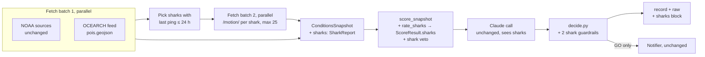

# Surf Check Agent — Shark Threat Veto Architecture (Step 2)

| | |
|---|---|
| **Status** | Draft v0.1, for review |
| **Implements** | [SPEC-shark-threat.md](SPEC-shark-threat.md) v0.2 |
| **Extends** | [ARCHITECTURE.md](ARCHITECTURE.md) v0.1 |
| **Date** | 2026-10-30 |

---

## 1. Design in one paragraph

The shark check is **one more source and one more veto** in the existing workflow. No new stages, no new model calls, and no tool use. The OCEARCH feed is fetched in the same parallel batch as NOAA. The few sharks that pinged in the last 24 hours get their tracks fetched in a second small batch. `snapshot.py` turns every ping inside 10 miles into a `SharkPing` with its distance and age. A new pure module, `sharks.py`, rates each shark. `scoring.window_vetoes` adds a `shark` veto when any rating reaches the threshold. From there the existing guardrails do the rest: `decide.py` turns any veto into NO_GO, and the notifier only fires on GO. Claude sees the shark findings, but can't change the outcome.

## 2. Pipeline changes



Batch 2 is the only new sequential step. With today's feed it's one request (§9), well inside the 60 s run budget.

## 3. Data source details (verified live 2026-10-30)

| Request name (= raw file stem) | URL | Response shape | Notes |
|---|---|---|---|
| `sharks` | `https://www.mapotic.com/api/v1/maps/3413/pois.geojson/` | GeoJSON `FeatureCollection`, 470 features, ~430 KB | Fields in SPEC-shark-threat §4 |
| `shark_track_<id>` | `https://www.mapotic.com/api/v1/maps/3413/pois/<id>/motion/` | JSON **list** of `{dt_move, point: {type: Point, coordinates: [lon, lat]}, import_id}`, oldest first | 308 pings / 39 KB for the white shark "Contender". Contains **duplicate pings** (same time and position, different `import_id`), so dedupe on `(dt_move, coordinates)` |

**Neither endpoint sends `Cache-Control` or `Expires`.** The current `LiveFetcher` only caches when the server sends a `max-age`, so it would never cache these. See §5.1 for the fix.

Timestamps are UTC with a `Z` suffix and sometimes fractional seconds (`2026-10-30T17:44:19.809000Z`). Parse them with `datetime.fromisoformat` after replacing `Z`, which handles both on Python 3.12.

## 4. Data models (additions to `models.py`)

```python
class SharkPing(BaseModel):            # one ping inside the radius and the lookback
    time: datetime                     # UTC
    lat: float
    lon: float
    distance_mi: float                 # haversine from spot lat/lon, statute miles
    age_h: float                       # run_at - time

class SharkSighting(BaseModel):        # one shark with ≥ 1 ping inside radius + lookback
    id: int
    name: str
    species: str                       # raw feed text, e.g. "White Shark (Carcharodon carcharias)"
    stage_of_life: str | None
    length: str | None                 # display only
    pings: list[SharkPing]             # only the qualifying ones
    track_used: bool                   # False = latest position only (track fetch failed or capped)

class SharkReport(BaseModel):          # lives on ConditionsSnapshot.sharks
    status: Literal["checked", "unavailable", "not_captured", "disabled"]
    detail: str | None = None          # why unavailable, e.g. "HTTP 503", "schema changed"
    feed_animals: int = 0
    feed_sharks: int = 0
    sharks_in_lookback: int = 0        # anywhere in the world
    tracks_fetched: int = 0
    tracks_truncated: bool = False
    nearby: list[SharkSighting] = []   # inside the radius only

class SharkRating(BaseModel):          # deterministic, lives on ScoreResult.sharks
    id: int
    name: str
    species_key: str | None            # matched scientific name, None = unknown species
    species_weight: float
    stage_factor: float
    recency_factor: float
    distance_factor: float
    threat: float                      # product, rounded to 2 dp
    worst_ping: SharkPing              # the ping that produced `threat`
```

Changes to existing models:
- `ConditionsSnapshot.sharks: SharkReport | None = None`. `None` means the snapshot came from somewhere that predates sharks (old synthetic scenarios); it's treated exactly like `not_captured`.
- `ScoreResult.sharks: list[SharkRating] = []`, sorted by `threat` descending.
- `Veto.code` gains `"shark"`.

Only sharks **inside the radius** go into the snapshot, so Claude never sees the other ~400 animals and the prompt grows by a few hundred tokens at most.

## 5. Module changes

| File | Change |
|---|---|
| `sources/http.py` | `Request.min_cache_s: int = 0`. `_cache_put` uses `max(server max-age, min_cache_s)`. `ReplayFetcher` raises `NotCaptured(SourceError)` when a raw file is missing, instead of a plain `SourceError` (existing callers are unaffected because it's a subclass) |
| `sources/ocearch.py` *(new)* | `feed_request()`, `track_request(id)`, `parse_feed(body) -> list[FeedShark]`, `parse_track(body) -> list[(time, lat, lon)]`. Raises `FeedSchemaError` when `features`, `category_name.en`, `species` or `geometry.coordinates` are missing |
| `snapshot.py` | Adds `ocearch.feed_request()` to batch 1. After batch 1, selects sharks whose `last_move_datetime` is within the lookback, takes the 25 closest by latest position, fetches their tracks in batch 2, and builds `SharkReport` (§6) |
| `sharks.py` *(new, pure)* | `haversine_mi()`, `match_species()`, `stage_factor()`, `recency_factor()`, `distance_factor()`, `rate_sharks(report, cfg) -> list[SharkRating]` |
| `scoring.py` | `score_snapshot` calls `rate_sharks` before `window_vetoes` and fills `ScoreResult.sharks`. `window_vetoes` gains a `ratings: list[SharkRating]` parameter and adds the `shark` veto (§7). Its only caller is `score_snapshot`, so nothing else changes. Shark ratings never touch the hourly or base score |
| `config.py` | `SharkConfig` model mirroring SPEC-shark-threat §10. `load_scoring()` also reads `config/sharks.yaml` into `ScoringConfig.sharks` (missing file → disabled). `scoring_version` becomes `"<scoring version>+sharks-<sha8 of sharks.yaml>"` so eval reports pin both |
| `decide.py` | Two new guardrails (§8) and a shark clause in `template_explanation` |
| `pipeline.py` | Adds a `sharks` block to the record (SPEC-shark-threat §7.1). No other change: the veto flows through `decide` and `should_wake` as is |
| `prompts/system.md` | Adds the shark veto to the veto list and three rules (§8.2). Changes `prompt_version`, so the next eval run is the new baseline |
| `testing.py` | `make_snapshot(sharks=[{species, stage, distance_mi, age_h, ...}])` builds a `SharkReport(status="checked")` relative to the fixed run time; `sharks_status="unavailable"` builds a failed one |
| `evals/graders.py` | Two new checks (§10) |
| `config/sharks.yaml` *(new)* | Exactly SPEC-shark-threat §10 |

`cli.py`, `llm.py`, `notify/*` and `records.py` don't change. `llm.user_message` already dumps the whole snapshot and score, so the shark fields reach Claude automatically.

### 5.1 Caching (courtesy rule)
Both requests set `min_cache_s = cache_minutes × 60` (1800 s). Within 30 minutes, repeated runs and replays of a live run hit `data/http-cache/` instead of Mapotic. The cache is never served past its expiry, and `config.py` rejects `cache_minutes` greater than `stale_after_hours × 60`, so the spec's "older than 2 h counts as unavailable" rule holds by construction.

## 6. Building the `SharkReport` (in `snapshot.py`)

```
if not cfg.enabled:                       → status "disabled"
feed = raw["sharks"]
  NotCaptured                             → status "not_captured"   (replay of an old run)
  other exception / FeedSchemaError       → status "unavailable", detail = error; "sharks" → missing_sources
sharks = features where category_name.en == "Sharks"
recent = sharks with last_move_datetime within lookback_hours of run_at   (null datetime → skipped)
to_track = 25 closest of `recent` by latest position; tracks_truncated = len(recent) > 25
batch 2: fetch_all(track_request(id) for id in to_track)
for each shark in recent:
  pings = track pings (deduped) if its track loaded, else [latest position]
  keep pings with age_h ≤ lookback_hours and distance_mi ≤ radius_mi
  if any → SharkSighting(track_used=track loaded)
  a failed track fetch logs shark_track_failed:<id> and falls back to the latest position
```

`run_at` is the snapshot's `run_at`, which on replay comes from `meta.json`. Ages are therefore reproducible, and a promoted real run grades the same forever.

Raw files land next to the NOAA ones: `raw/sharks.json` and `raw/shark_track_<id>.json`. The existing `save_run` already writes everything in `fetcher.raw`, so nothing changes there.

## 7. Rating and veto (in `sharks.py` and `scoring.py`)

```python
def rate_sharks(report: SharkReport | None, cfg: SharkConfig) -> list[SharkRating]:
    if report is None or report.status != "checked":
        return []
    out = []
    for s in report.nearby:
        key, weight = match_species(s.species, cfg)        # scientific name first, then aliases
        stage = cfg.stage_factors.get(s.stage_of_life, 1.0)
        best = max(s.pings, key=lambda p: weight * stage * recency(p.age_h) * distance(p.distance_mi))
        ...
    return sorted(out, key=lambda r: r.threat, reverse=True)
```

- `match_species` pulls the text inside the parentheses (`Carcharodon carcharias`) and looks it up case-insensitively. It then tries the aliases against the common-name part, then falls back to `unknown_species_weight` and logs `shark_species_unmapped`.
- Factor lookups are **upper-inclusive** (`age_h ≤ 6 → 1.0`, `distance_mi ≤ 10 → 0.6`), unlike the lower-inclusive buckets in `scoring.yaml`. Each gets a dedicated helper and boundary tests, so the two conventions can't get mixed up.
- `threat` is rounded to 2 decimals **before** it's compared with the threshold, so the recorded number and the veto decision always agree.

In `window_vetoes`:

```python
top = next((r for r in ratings if r.threat > 0 and r.threat >= cfg.sharks.veto_threshold), None)
if top:
    out.append(Veto(code="shark", detail=f"{top.name} ({species common name}), "
                    f"{top.worst_ping.distance_mi:.1f} mi, {top.worst_ping.age_h:.0f} h ago, threat {top.threat:.2f}"))
elif snap.sharks and snap.sharks.status == "unavailable" and cfg.sharks.on_missing_data == "sleep":
    out.append(Veto(code="shark", detail="shark tracker unavailable (on_missing_data: sleep)"))
```

One `shark` veto per run, naming the highest-threat shark. Every qualifying shark is in `ScoreResult.sharks` and the record.

## 8. Claude and the guardrails

### 8.1 What Claude sees
`conditions_snapshot.sharks` (the report, with only the nearby sharks) and `deterministic_score.sharks` (the ratings). Claude doesn't rate sharks and can't change a rating.

### 8.2 Prompt additions (`prompts/system.md`)
1. In the veto list: *"a tagged shark rated at or above the threat threshold within 10 miles in the last 24 hours."*
2. *"Sharks are handled only by the veto. Never use shark reports as a reason for an adjustment."*
3. *"Never say or imply the water is safe from sharks. Tags only report when a shark surfaces. If nothing was reported, say nothing about sharks or say 'no tagged sharks reported nearby'. If `sharks.status` is `unavailable`, say the shark tracker was unavailable."*
4. *"Never mention sharks in `spoken_message`."*

### 8.3 Code guardrails (`decide.py`)
The prompt rules are backed by code, as with the existing guardrails:

| # | Guardrail | On violation |
|---|---|---|
| 6 | `adjustment_reason` mentions `shark` | Adjustment set to 0, note `adjustment dropped: cites sharks` |
| 7 | `explanation` matches the unsafe-wording list (`no sharks`, `shark-free`, `shark free`, `all clear`, `safe from sharks`, `no shark activity`) | Replaced by `template_explanation`, note `explanation failed shark wording check` |
| 4 *(extended)* | `spoken_message` contains `shark` | Fails `spoken_message_ok`, so the template is used |

`template_explanation` gains one clause: the shark veto detail when there is one, or *"Shark tracker unavailable."* when `status == "unavailable"`. It never says anything about sharks when the status is `checked` and nothing was found.

## 9. Cost and latency

| | Today's feed | Worst case |
|---|---|---|
| Feed request | 1 × ~430 KB, cached 30 min | same |
| Track requests | 1 (one shark pinged in the last 24 h) | 25 (cap), in parallel |
| Added latency | ~1 s (batch 2 runs after batch 1) | ~2–3 s |
| Added Claude input tokens | ~50 (empty report) | ~600 (a few nearby sharks) |
| Added cost per run | < $0.0002 | < $0.002 |

Still inside the SPEC §9 targets (< 60 s, < $0.02).

## 10. Tests and evals

| Layer | Additions |
|---|---|
| **L1** `tests/test_sharks.py` | Haversine against two reference points; every factor boundary (3 / 6 / 10.0 / 10.01 mi; 6 / 12 / 24 h and 24 h + 1 min); every row of SPEC-shark-threat §5.5; species match by scientific name, alias and unknown; `threat` rounding at the threshold (0.195 vs 0.2) |
| **L1** `tests/test_sources.py` | `parse_feed` on a trimmed copy of the real GeoJSON (non-shark categories, null `length`, null `last_move_datetime`); `parse_track` dedupe; schema-change error |
| **L2** `tests/test_pipeline.py` | Shark veto + perfect waves + stubbed adjustment +1 → NO_GO, notifier not called; feed HTTP 503 → GO with `ignore`, NO_GO with `sleep`; track fetch fails → latest position used; replay without `sharks.json` → `not_captured`, decision unchanged; stubbed explanation "no sharks around" → template; stubbed `adjustment_reason` citing a shark → adjustment 0 |
| **L3** `evals/scenarios/synthetic/shark-*.yaml` | The 10 scenarios in SPEC-shark-threat §9.3, written with the new `sharks:` input |
| **L3** `evals/scenarios/real/` | Promote one real run once a shark pings near Juno (none today) |

**Graders (`evals/graders.py`):**
- Veto recall already covers `shark` through `expect.vetoes`. No change needed.
- New per-row check `shark_wording_ok`: explanation and spoken message pass the §8.3 wording list. Gate: 100%.
- New per-row check `adjustment_no_shark`: `adjustment_reason` doesn't mention sharks. Gate: 100%.
- Grounding check: shark distances, ages and threats come from the snapshot and score, so `allowed_numbers` already accepts them. Ages are added as rounded hours.

All existing scenarios keep passing unchanged: their snapshots have `sharks = None` (synthetic) or no `sharks.json` (the real fixture), so the status is `not_captured` and nothing changes.

## 11. Build order (step 3)

1. Models, `sharks.yaml`, `SharkConfig`, `sharks.py` with L1 tests (pure, no I/O).
2. `ocearch.py` and the `http.py` changes, with fixtures trimmed from the live responses captured today.
3. `snapshot.py` wiring and the `ReplayFetcher` `NotCaptured` path, with L2 tests.
4. `scoring.py` veto, `decide.py` guardrails and the record block, with L2 tests.
5. Prompt changes, the new scenarios and graders, then one `eval --no-llm` and one `eval` run on Sonnet 5.5 to set the new baseline.

## 12. Risks

| Risk | Mitigation |
|---|---|
| Mapotic changes or removes the endpoints | `FeedSchemaError` → `unavailable` + loud log. The run still decides (`ignore`). A schema-change test uses the captured fixture |
| Feed rate-limits us | 30-min cache, ≤ 26 requests a run, descriptive `User-Agent`. Production runs once a day |
| A species is renamed in the feed | Matching on the scientific name. Unmapped species get 0.5 and a log line, never 0 |
| Veto almost never fires, so it's hard to trust | Synthetic L2/L3 scenarios exercise it on every eval run, independent of real-world shark traffic |
| Someone reads "no tagged sharks reported" as safe | Wording rules in the prompt, a code guardrail and an eval gate (§8) |

## 13. Decisions needed

None. Two implementation choices to flag, both following the spec:
- **One veto per run**, naming the highest-threat shark, rather than one per shark. The other sharks are in the record.
- **`on_missing_data: sleep` uses the `shark` veto code** with an "unavailable" detail, rather than adding a separate veto code. It's off by default.
