# Surf Check Agent — Architecture (Step 2)

| | |
|---|---|
| **Status** | Draft v0.1, for review |
| **Implements** | [SPEC.md](SPEC.md) v0.1 |
| **Date** | 2026-10-30 |

---

## 1. Design in one paragraph

Code fetches every NOAA source in parallel, turns the results into one compact **conditions snapshot**, and runs the **deterministic scorer** from SPEC §6. Then it makes **one Claude call** with the snapshot and the score. Claude returns a strictly structured assessment: a bounded score adjustment, an explanation and the spoken message. Code then applies the vetoes and thresholds, makes the final decision, and only then decides whether to fire the Alexa trigger. Claude never calls Alexa itself and can't get around a veto, because those steps run in code after it answers.

### Why a workflow and not a tool-calling agent loop
Every data source is known ahead of time, so there's nothing for the model to explore. A fixed workflow is:
- **Cheaper:** one model call instead of 5–10 tool-calling rounds.
- **Faster:** the fetches run in parallel, with no back-and-forth between model and tools.
- **Safer:** the model's output is pure data, and code owns every action.
- **Testable:** each stage is a pure function with fixtures.

Claude adds value exactly where a formula can't: reading NWS text forecasts, reconciling sources that disagree, spotting trends, and explaining the call in plain words. If we later want "look at a webcam" or "check a second spot," that becomes the point to add tools.

## 2. Pipeline

```mermaid
flowchart LR
    CLI[surf-check CLI] --> CFG[Load + validate config]
    CFG --> FETCH
    subgraph FETCH[Fetch in parallel, asyncio]
      G[NWS gridpoints<br/>waves, wind, PoP, thunder]
      CWF[NWS Coastal Waters Forecast<br/>+ Wave Detail parser]
      AL[NWS alerts<br/>FLZ168 + AMZ650]
      B[NDBC wave buoy]
      W[NDBC/C-MAN wind]
      T[CO-OPS tides]
    end
    FETCH --> SNAP[Normalize → ConditionsSnapshot<br/>session window only, units to ft/kt]
    SNAP --> SCORE[Deterministic scorer<br/>vetoes + hourly scores + best block]
    SCORE --> LLM[Claude: one structured call<br/>→ Assessment]
    LLM --> DECIDE[Decide in code<br/>clamp ±1, vetoes win, thresholds]
    SCORE -. LLM unavailable .-> DECIDE
    DECIDE --> REC[Write decision record<br/>+ raw snapshot]
    DECIDE -->|GO and not already woken today| NOTIFY[Notifier<br/>Voice Monkey / dry-run]
```



| Stage | Module | Pure? | Notes |
|---|---|---|---|
| Config | `config.py` | yes | Pydantic models; fails fast with readable errors |
| Fetch | `sources/*.py` | no (I/O) | `httpx.AsyncClient`, per-source timeout, 2 retries with backoff, disk cache |
| Normalize | `snapshot.py`, `sources/cwf_parse.py` | yes | Converts m→ft, m/s and km/h→kt, ISO8601 intervals→hourly; drops stale data per freshness rules |
| Score | `scoring.py` | yes | Exactly SPEC §6. No I/O, no LLM. Fully unit-tested |
| Assess | `llm.py` | no | One `messages.parse()` call; structured output |
| Decide | `decide.py` | yes | The only place a decision is made; enforces guardrails |
| Record | `records.py` | no | JSONL log + raw fixture capture for replay |
| Notify | `notify/*.py` | no | Interface + Voice Monkey + console (dry run); idempotency state |

## 3. Data sources

All of these were verified with live requests on 2026-10-30 (see §11).

| Source | Endpoint (Juno values) | Fields used | Units in → out | Server cache | Freshness limit |
|---|---|---|---|---|---|
| NWS gridpoint | `api.weather.gov/gridpoints/MFL/111,100` | waveHeight, wavePeriod, primarySwellHeight, windSpeed, windDirection, windGust, probabilityOfPrecipitation, probabilityOfThunder, weather | m→ft, km/h→kt | 1 h | 12 h |
| Coastal Waters Forecast | `api.weather.gov/zones/marine/AMZ650/forecast` (structured periods); raw text via `/products/types/CWF/locations/MFL` | Seas, **"Wave Detail" swell components (direction, height, period)**, T-storm wording | ft, s | 2 min | 12 h |
| Alerts | `api.weather.gov/alerts/active?zone=FLZ168,AMZ650` | event, severity, onset/ends | — | 5 s | live |
| Wave buoy | `ndbc.noaa.gov/data/realtime2/41114.txt` (+ `.spec` for swell/wind-wave split) | WVHT, DPD, MWD | m→ft | 10 min | 2 h |
| Wind obs | `ndbc.noaa.gov/data/realtime2/LKWF1.txt`; fallback `api.weather.gov/stations/KDJT/observations/latest` | WDIR, WSPD, GST | m/s→kt | 10 min | 2 h |
| Tides (optional) | `api.tidesandcurrents.noaa.gov/api/prod/datagetter?station=8722495&begin_date=…&range=48&interval=hilo` | hi/lo predictions | ft | none | 24 h |
| Dawn / sunrise | computed locally (`astral`) | civil dawn, sunrise | — | — | — |

### Data findings that shape the design
- **Swell direction is not reliable in the gridded forecast.** `waveDirection` is empty, and `primarySwellDirection` is one constant value for days (0 in the pier cell, which looks like a placeholder). The direction factor therefore comes from, in order of preference:
  1. The parsed **CWF "Wave Detail"** line, e.g. *"N 6 ft at 7 seconds and E 4 ft at 4 seconds"*. This is the richest source: one component per swell. A deterministic regex parser turns it into `[SwellComponent(dir, ft, s)]`.
  2. **Buoy 41114 `MWD`** (now-cast only).
  3. If neither is available, factor 0.8 with a `direction_unknown` data concern.
- **Wave height means seas, not surf.** Gridpoint `waveHeight` and the CWF "Seas" are combined offshore seas for 0–20 NM. Scoring uses the **dominant CWF swell component** when one is parsed, and otherwise gridpoint height and period. The period multiplier (SPEC §6.2) is a heuristic, to be calibrated with feedback.
- **Buoy 41114 is about 76 km north** and sits north of the Bahamas shadow line, so it can over-read for Juno. It's used as a sanity check and for "right now," not as the primary input. The prompt tells Claude this explicitly.
- **Alerts need both zones.** A single point query returns only land *or* only marine alerts, never both.
- **Gridpoint values are run-length intervals** (`…/PT11H`), so they're expanded to hourly before scoring.
- **Gridpoint `probabilityOfThunder` has no `uom` key**, so the parser can't assume one.
- **Time zone:** DST ends Nov 1. All window math uses `zoneinfo` (America/New_York), never fixed offsets.

**HTTP rules:** every NWS request sends `User-Agent: surf-check-agent (<contact email from env>)`. Responses are cached on disk under `data/http-cache/`, keyed by URL and honoring `Cache-Control`/`Expires`. One failed source never fails the run; it only marks that source missing (SPEC §10).

## 4. Core data models (Pydantic)

```python
class HourConditions(BaseModel):
    time: datetime                     # local, top of hour
    wave_height_ft: float | None       # forecast significant height
    wave_period_s: float | None        # dominant / primary swell period
    swell_dir_deg: float | None
    wind_kt: float | None
    gust_kt: float | None
    wind_dir_deg: float | None
    pop_pct: int | None                # probability of precipitation
    thunder_pct: int | None
    weather_text: str | None           # e.g. "Chance Showers And Thunderstorms"

class ConditionsSnapshot(BaseModel):
    spot_id: str
    run_at: datetime
    window: tuple[datetime, datetime]  # dawn → 08:30
    hours: list[HourConditions]
    buoy_now: BuoyObs | None           # height_ft, period_s, dir_deg, observed_at
    wind_now: WindObs | None
    marine_text: str | None            # trimmed to today's + tonight's periods only
    alerts: list[Alert]
    tide: list[TideEvent] | None
    missing_sources: list[str]
    source_times: dict[str, datetime]

class ScoreResult(BaseModel):          # deterministic
    vetoes: list[Veto]
    hourly: list[HourScore]            # face_ft, size, quality, direction, wind_factor, weather_factor, score
    best_block: BlockScore             # start, end, score
    base_score: float

class Assessment(BaseModel):           # Claude's structured output
    adjustment: float                  # schema bounds −1.0..+1.0; clamped again in code
    adjustment_reason: str | None
    data_concerns: list[str]           # e.g. "buoy reading 1.2 ft vs forecast 3 ft"
    confidence: Literal["high", "medium", "low"]
    explanation: str                   # 2–3 sentences
    spoken_message: str                # ≤ 25 words, ear-friendly, no symbols

class Decision(BaseModel):
    decision: Literal["GO", "MAYBE", "NO_GO"]
    final_score: float
    reasons: list[str]
    vetoes: list[Veto]
    llm_used: bool
```

## 5. The Claude call

| Setting | Value | Why |
|---|---|---|
| SDK | `anthropic` Python SDK, `client.beta.messages.create` with `output_config.format` (JSON schema), validated into the `Assessment` Pydantic model | Schema-constrained output; no hand-parsing free text. The beta client carries the refusal-fallback parameter |
| Model | **`claude-sonnet-5-5`**, set in config (`llm.model`) | Chosen from the eval: same decisions as Opus 5.5 on all 35 scenarios at under half the cost and ~40% lower latency (see §12, EVAL_RESULTS.md). `--model` overrides it per run |
| Thinking / effort | Adaptive thinking (Sonnet 5.5's default; `thinking` is omitted), `output_config.effort: "low"` | A bounded judgment task. Low effort keeps latency and cost down; evals confirm quality holds |
| `max_tokens` | 4000 | Room for thinking plus a small JSON output |
| Refusal fallback | `betas=["server-side-fallback-2026-07-01"]`, `fallbacks="default"`; always check `stop_reason` | Recommended for current models; Sonnet 5.5 accepts only the `"default"` form. A weather question won't realistically trip it, but it costs nothing |
| Timeout / retries | 60 s, SDK `max_retries=2` | Fits the < 60 s run target. On final failure, use the deterministic-only decision |

### Prompt layout (cache-friendly order)

```
system:
  [block 1] Role + rubric: SPEC §6 tables, veto list, adjustment rules,
            output rules, 4–6 worked examples  ── static, versioned in prompts/system.md
  [block 2] Spot profile + user preferences (YAML dump, sorted keys)  ── static per spot
            └── cache_control breakpoint here (when caching is on)
messages:
  user: ConditionsSnapshot (compact JSON, sorted keys, rounded values)
        + ScoreResult (deterministic)  ── volatile, after the breakpoint
```

- The static prefix target is **about 2–3K tokens**, well over Sonnet 5.5's 512-token minimum for caching (measured: about 2.7K). A `live`-marked test checks this with `client.messages.count_tokens`.
- **Nothing that varies goes in `system`:** no dates, no "today is …". The run date lives only in the user message, which keeps the prefix byte-identical across runs.
- The prompt file's SHA-256 (`prompt_version`) goes in every decision record, so eval results can be tied to an exact prompt.

### Prompt caching: where it pays and where it doesn't
| Situation | Calls sharing the prefix within 5 min | Caching? |
|---|---|---|
| **Daily production run** | 1 call per day; any cache expires long before tomorrow | **Off by default.** A cache write costs 1.25× and nothing would read it. Becomes "on" automatically if a run makes a retry or second call |
| **Eval suite (sync mode)** | 25–50 calls back to back | **On (5-min TTL).** The first call writes; the rest read at 0.1× input price ($0.20/MTok on Sonnet 5.5). Measured hit rate: 73% of input tokens |
| **Eval suite (Batch API)** | many | **On.** Batch gives 50% off and caching is best-effort on top |
| **Iterating on the prompt locally** | several runs within minutes | On (set `llm.prompt_cache: on`) |

Config: `llm.prompt_cache: auto | on | off`. `auto` turns it on for evals and multi-call runs. Every record logs `cache_creation_input_tokens` and `cache_read_input_tokens`, and the eval report shows the hit rate. A zero read count across an eval run fails a check (it's a silent-invalidator alarm).

### Guardrails (enforced in `decide.py`, never trusted to the model)
1. A veto from the scorer means NO_GO, regardless of the model's output.
2. `adjustment` is clamped to ±1.0, and a nonzero adjustment with an empty `adjustment_reason` is treated as 0.
3. The thresholds (GO ≥ 6.0, MAYBE ≥ 4.5) are applied in code.
4. `spoken_message` is checked: ≤ 25 words, no URLs or markup. If it fails, a deterministic template message is used instead.
5. The model output can't trigger the notifier. Only `decide.py`'s decision can.

### Cost per run (measured)
About 4–5K input tokens and ~320 output tokens per call. On **Sonnet 5.5** ($2 / $10 per MTok) that is **≈ $0.01 per daily run**, within SPEC's $0.02 target. Opus 5.5 ($4 / $20) measured $0.02–0.03 per uncached run.

## 6. Decision logic placement

`scoring.py` implements SPEC §6 as pure functions:

```python
face_height_ft(height_ft, period_s) -> float
period_quality(period_s) -> float
size_score(face_ft, prefs) -> float
swell_direction_factor(swell_deg, spot) -> float
wind_class(wind_dir_deg, spot) -> WindClass
wind_factor(wind_kt, wind_class) -> float
weather_factor(pop_pct, alerts) -> float
vetoes(snapshot, hourly, prefs) -> list[Veto]
score_hour(hour, spot, prefs) -> HourScore
best_block(hourly, block_hours, window) -> BlockScore   # whole window if it's shorter than block_hours
```

All of the tables (period buckets, wind matrix and so on) live in `config/scoring.yaml`, not in code. That way, tuning from feedback is a config change, and the eval report records which scoring version was used.

## 7. Notifier (Alexa)

```python
class Notifier(Protocol):
    def wake(self, message: str, *, dry_run: bool) -> NotifyResult: ...
```
- `VoiceMonkeyNotifier` uses **Voice Monkey API v3** (`https://api-v3.voicemonkey.io`). v2 is legacy and shuts down by December 2026. In v3 a routine trigger **can't carry text**, so a wake-up is two calls:
  1. `POST /trigger` with `{"device": $VOICEMONKEY_TRIGGER_DEVICE}` fires your **"Surf Wake" routine**. You design it in the Alexa app.
  2. After a configurable pause (`announce_delay_s`, default 20 s, so your routine's alarm sound finishes first), `POST /announce` with `{"device": $VOICEMONKEY_SPEAKER_DEVICE, "speech": spoken_message, "voice": "Joanna", "language": "en-US"}` makes the bedroom Echo speak the summary.
  - **Auth:** `Authorization: Bearer $VOICEMONKEY_TOKEN`, with a fallback to `token` in the JSON body. It never goes in the query string, so it stays out of logs. Use a dedicated token for this agent; v3 supports more than one, so it can be revoked on its own.
  - **Success** means `{"success": true}`.
    - 429 `THROTTLED`: wait until `lockoutUntil`, once.
    - 500 `ALEXA_TRIGGER_FAILED`: retry with backoff.
    - 401 / 404: fail immediately with a clear config error.
  - If the trigger succeeds but the announcement fails, it's still recorded as **woken**. The routine is the part that wakes you; the announcement is a bonus.
  - **Free plan is enough:** 3 routine triggers, 5 speakers and 200 sends a month, and this uses about 60.
- `ConsoleNotifier`: prints what it would do. Used for `--dry-run`, evals and tests.
- **Idempotency:** `data/state/wakeups.json` records `{spot_id: last_wake_date}`. A second GO on the same day logs `already_woken` and sends nothing. `--force-wake` overrides it for testing.
- Retries twice with backoff, then logs `notify_failed` (SPEC §10).

### Your one-time Alexa setup (from the research)
1. Enable the Voice Monkey skill. In the Voice Monkey console, create a **Routine Trigger** named "Surf Wake" and a **Speaker** named "Bedroom".
2. In the Alexa app, create a routine. *When:* Smart Home → Alexa Voice Monkey v3 → "Surf Wake". *Actions, in order:*
   1. **Turn off Do Not Disturb.** DND silences announcements; it's the biggest reliability risk.
   2. Set the volume to 7–8.
   3. Play a Sounds alarm or music.
3. Create a second routine for the Speaker. *When:* "Bedroom" speaker event. *Action:* the Voice Monkey skill, with "From" set to the bedroom Echo.
4. **Live test needed:** whether a smart-home-triggered routine runs while DND is on hasn't been documented. We test it once with `surf-check notify-test` during the build.
5. **Safety net (recommended):** keep a normal Alexa alarm a bit later (e.g. 6:45) as a backstop. Voice Monkey publishes no delivery guarantee.

## 8. Records, replay and feedback

```
data/                         # gitignored
  runs/2026-10-30T0500/
    raw/*.json                # every raw HTTP response, so this run can be replayed exactly
    snapshot.json
    score.json
    assessment.json
    record.json               # the decision record (SPEC §7.2)
  decisions.jsonl             # one line per run; quick history
  feedback.jsonl              # surf-check feedback entries
  state/wakeups.json
  http-cache/
```
- `--replay data/runs/<id>` swaps the HTTP layer for the saved raw files, so the exact same pipeline runs offline.
- `surf-check eval promote <run-id> --expected NO_GO` copies a real run into `evals/scenarios/real/` as a labeled fixture. This is the feedback loop from SPEC §8.3.

## 9. Evaluation architecture

Three layers, from cheapest and fastest to most realistic:

| Layer | What | Runs | LLM? | Gate |
|---|---|---|---|---|
| **L1 Unit** | `scoring.py`, `snapshot.py` unit conversions, `decide.py` guardrails, the SPEC §6.6 worked examples | `pytest` on every change | no | 100% pass |
| **L2 Pipeline (mocked LLM)** | Fixture snapshot → score → *stubbed* assessment (including hostile cases: adjustment +5, empty reason, 60-word message) → decide → notifier | `pytest` | no | 100% pass. Proves the guardrails hold even if the model misbehaves |
| **L3 Agent eval** | ≥ 25 labeled scenarios through the real Claude call | `surf-check eval [--batch] [--model X]` | yes | SPEC §8.2 bars |

**Scenario format** (`evals/scenarios/*.yaml`):
```yaml
id: lightning-perfect-waves
tags: [veto, safety]
snapshot: { ... ConditionsSnapshot, hand-written or captured ... }
expect:
  decision: NO_GO
  must_include_veto: lightning
  adjustment_range: [-1, 0]      # optional
  explanation_mentions: [thunder]  # optional
```
Two sources: **synthetic** (written by hand to hit each edge case in SPEC §8.2) and **real** (promoted from captured runs).

**Graders**
- **Code-based (primary):** decision match, veto recall, false-wake count, adjustment bound, spoken-message length. **Grounding check:** every number in `explanation` and `spoken_message` must match a value in the snapshot or score within rounding.
- **LLM judge (secondary, for explanation quality; `eval --judge`):** six pass/fail criteria in `evals/judge_prompt.md`: deciding factor first, faithful to the data, consistent with the decision, sound adjustment reasoning, a spoken message that works half-asleep, and honesty about the data. Pass/fail claims replace a vague 1–5 scale.
  - **Judge model: Opus 5.5** at medium effort. It is deliberately *not* the model under test (Sonnet 5.5), to avoid self-preference bias.
  - **Input:** the judge sees exactly what the assessment model saw: the spot profile, the snapshot and the score. It also gets the final decision. The output being graded is wrapped in tags as untrusted data.
  - **Output:** structured JSON. Each reason ends with an explicit verdict, and code flags any reason/verdict mismatch. There is no refusal fallback, and a substituted served model counts as an error.
  - **Audit** (`pytest -m live tests/test_judge.py`): the judge must fail an empty answer, "I don't know", a confidently wrong answer and a prompt-injection attempt, and must pass a hand-written correct answer.
  - **Status: report only.** Rob agreed with all 5 pilot grades on 2026-10-30. It becomes a gate after more agreement checks.

**Execution modes**
- `eval` (sync): runs sequentially with caching on, for quick iteration (~1–2 min).
- `eval --batch`: Message Batches API at 50% cost. Results are keyed by `custom_id` (they arrive in any order).
- `eval --model claude-sonnet-5-5 --effort low`: runs the same suite on another model, producing a side-by-side table of accuracy, veto recall, cost per run and latency.

**Report:** `evals/results/<timestamp>-<model>.json` plus a Markdown summary showing the metrics, pass/fail against each bar, the cache hit rate, total cost, each scenario that failed with a diff, and the change from the previous run.

## 10. Project layout and tooling

```
surf-agent/
  pyproject.toml              # uv-managed; Python 3.12
  .env.example                # ANTHROPIC_API_KEY, VOICEMONKEY_TOKEN, VOICEMONKEY_TRIGGER_DEVICE,
                              # VOICEMONKEY_SPEAKER_DEVICE, NWS_CONTACT_EMAIL
  config/
    settings.yaml             # active spot, preferences, llm settings
    scoring.yaml              # SPEC §6 tables
    spots/juno-beach-pier.yaml
  prompts/system.md
  src/surf_agent/
    cli.py  config.py  snapshot.py  scoring.py  llm.py  decide.py  records.py
    sources/  nws.py  cwf_parse.py  ndbc.py  tides.py  sun.py  http.py
    notify/   base.py  voicemonkey.py  console.py
  tests/                      # L1 + L2
  evals/
    scenarios/{synthetic,real}/*.yaml
    runner.py  graders.py
    results/
  docs/  SPEC.md  ARCHITECTURE.md
```

**Dependencies (kept minimal):** `anthropic`, `httpx`, `pydantic`, `pyyaml`, `typer`, `astral`, `python-dotenv`. Dev: `pytest`, `pytest-asyncio`, `respx` (HTTP mocking), `ruff`.

**Secrets:** loaded from the environment or a `.env` file (gitignored). Nothing secret goes in config or logs; the notifier redacts tokens from error messages.

## 11. Verification status of external endpoints

Checked live on 2026-10-30 at about 20:45Z.

| Endpoint | Status |
|---|---|
| `api.weather.gov/points/{lat},{lon}` | ✅ Verified (the pier point is over water and returns AMZ650; the land end returns FLZ168) |
| `api.weather.gov/gridpoints/MFL/111,100` | ✅ Verified (marine fields populated except direction; see §3) |
| `api.weather.gov/zones/marine/AMZ650/forecast` | ✅ Verified (11 periods, with `detailedForecast`) |
| `api.weather.gov/products/types/CWF/locations/MFL` → `/products/{id}` | ✅ Verified (AMZ650 segment, "Wave Detail" wording present) |
| `api.weather.gov/alerts/active?zone=FLZ168,AMZ650` | ✅ Verified (returned all 4 active alerts) |
| `api.weather.gov/stations/KDJT/observations/latest` | ✅ Verified (KPBI now returns 404; the airport station ID changed) |
| `ndbc.noaa.gov/data/realtime2/41114.txt` / `.spec` | ✅ Verified (30-min cadence; `#` headers, `MM` = missing) |
| `ndbc.noaa.gov/data/realtime2/LKWF1.txt` | ✅ Verified (6-min cadence) |
| CO-OPS predictions, station 8722495 | ✅ Verified |
| Voice Monkey v3 `/trigger`, `/announce` | 📄 Checked against the docs only; the live test happens in the build (`notify-test`) |
| Alexa routine fires while DND is on | ⏳ Needs a live test on your Echo |
| A Palm Beach wave buoy closer than 41114 | ❌ None found on NDBC (CDIP's own site not checked) |
| Gridpoint 5xx behavior | ⏳ Not observed in about 40 calls; retries are designed in anyway |

**Example (today's real data):** E winds 20–25 kt, seas 5–7 ft, "Wave Detail: N 6 ft at 7 s and E 4 ft at 4 s", a slight chance of thunderstorms, and a Small Craft Advisory. That is a clear **NO-GO** (gale-level onshore wind, short period). We capture it in the build as the first **real** eval fixture.

## 12. Decisions log (resolved 2026-10-30)

1. **Model:** the build started on Opus 5.5 at low effort, and the first eval ran Opus 5.5 and Sonnet 5.5 side by side. Both passed every gate with identical decisions, so **Rob switched production to Sonnet 5.5** (low effort) for the lower cost and latency.
2. **Language:** Python 3.12.

## 13. Later: scheduling (v2, recorded here so it doesn't get lost)

| Option | Pros | Cons |
|---|---|---|
| Windows Task Scheduler + "wake to run" | Free, already have the PC | The PC must be plugged in and allowed to wake; laptop sleep is unreliable |
| GitHub Actions cron | Free, no machine needed | Cron can start 5–30+ min late; secrets live in GitHub |
| Small cloud function (AWS Lambda / Azure Functions + timer) | Reliable on-time runs, pennies per month | Cloud setup and deployment to own |
| Claude Managed Agents scheduled deployment | No scheduler to run yourself | Built for agent loops; heavier than this workflow needs |

Recommendation for v2: a **small cloud function**. The pipeline is a single command, so moving it there is mostly packaging.
